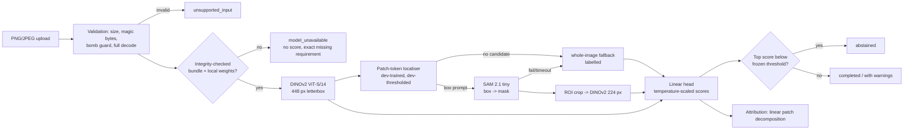

# OvaScope

**Ovarian ultrasound analysis with inspectable evidence.**

> **Research prototype. Not for diagnosis, screening, or treatment decisions.**
> Not clinically validated. No regulatory clearance. External validation not performed.

OvaScope is a full-stack research prototype for analysing already-acquired ovarian/adnexal
ultrasound stills. It asks two questions on the public MMOTU OTU_2d dataset:

1. Can frozen image representations distinguish the dataset's eight verified categories?
2. Does Meta-assisted lesion localisation (DINOv2 patch localiser → SAM 2.1 mask → ROI features)
   change performance compared with whole-image analysis?

Segmentation masks, classifier scores and attribution maps are produced by different components
and are shown separately, each labelled with its source, model identifier and limitations.
Without a trained, integrity-checked model bundle, the app runs in **NO_MODEL** mode and returns
`model_unavailable` with no score.

## Held-out results (image level; read the caveats)

MMOTU OTU_2d official test split, 469 images, evaluated once after selection was frozen on
development data. Image-level, single centre, **not patient-independent; external validation not
performed.** Full report: `docs/generated/EVALUATION_REPORT.md`.

| Model | Balanced accuracy (95% CI) | Macro AUROC (95% CI) |
|---|---|---|
| Majority class | 0.125 | 0.500 |
| Hand-crafted features | 0.394 (0.341-0.448) | 0.761 (0.726-0.795) |
| ImageNet ResNet-50 (frozen) | 0.514 (0.462-0.572) | 0.833 (0.799-0.867) |
| **DINOv2 whole image (deployed; chosen on development data)** | **0.482 (0.428-0.540)** | **0.841 (0.809-0.872)** |
| DINOv2 + automatic SAM 2.1 ROI | 0.523 (0.464-0.584) | 0.843 (0.812-0.874) |
| Oracle: DINOv2 + expert-mask ROI (upper bound) | 0.577 (0.520-0.635) | 0.889 (0.860-0.916) |

What the Meta components did, measured honestly:

- **DINOv2** clearly beats hand-crafted features (+0.088 balanced accuracy, CI 0.027-0.154) but shows
  **no clear difference** from a supervised ImageNet ResNet-50 (-0.032, CI -0.093 to 0.026).
- **Adding the automatic SAM ROI** was **not shown to help** (+0.041, CI -0.000 to 0.085); development
  data selected whole-image, and the deployed pathway was not changed after seeing test results.
- **SAM 2.1 masks** from automatic boxes were **worse** than the DINOv2 localiser's own masks
  (mean Dice 0.636 vs 0.730). Given an expert box, SAM reaches 0.789: the automatic prompt is the
  bottleneck.
- **Leakage warning:** test images with a development near-duplicate score 0.802 balanced accuracy
  (n=56) vs 0.453 for the other 413. Headline numbers are inflated by near-duplicates.
- "High grade serous" vs other: AUROC 0.815 (0.690-0.916) from only 15 positive images. Not a cancer
  detector; no stage labels exist.

## How an analysis flows



Segmentation (SAM mask), classifier scores and attribution are separate outputs with separate
provenance. Test labels and reference masks are only ever read by `ml/ovascope_ml/evaluation`.

## What is where

```
apps/web/                 Next.js 16 (App Router, TS, Tailwind 4, TanStack Query): research UI
services/api/             FastAPI + SQLAlchemy + Alembic; SQLite (dev) / PostgreSQL (Compose)
services/worker/          DB-polling analysis worker (compare-and-set job claims; no Redis)
ml/ovascope_ml/
  data/                   manifest schema, MMOTU adapter, validation, near-duplicates, shortcut audit, splits
  models/                 letterbox geometry, DINOv2/ResNet/hand-crafted extractors, linear heads, localiser
  providers/              SegmentationProvider, ImageClassifier, OptionalMultimodalProvider, ArtifactStore
  inference/              analysis engine, result contract, quality checks, overlay rendering
  training/               features -> localiser -> SAM -> ROI -> classifiers -> bundle export
  evaluation/             metrics, bootstrap, held-out evaluation, reports (only place test labels are read)
configs/mmotu_v1.yaml     the experiment configuration
tests/                    pytest (unit, API, integration); apps/web/tests (vitest), apps/web/e2e (Playwright)
docs/                     plan, decisions, dataset readiness, model card, security, claims ledger, demo script
infra/                    Dockerfiles, optional Modal adapter (gated; not executed here)
```

## Quick start (Windows, macOS, Linux)

Requirements: Python 3.11, Node 22, ~3 GB disk for dependencies, ~1.5 GB for weights and features.
`make` is optional; every target is also `python tasks.py <target>`.

```bash
python tasks.py setup            # .venv (hash-pinned lock, CPU torch) + npm ci
python tasks.py fetch-models     # pinned DINOv2 ViT-S/14 + SAM 2.1 tiny weights (public, Apache-2.0)
python tasks.py dev              # API :8000 (inline worker) + web :3000
```

Open http://localhost:3000. With no dataset or bundle you are in NO_MODEL mode: upload, validation,
viewer, report export and deletion all work; no score is produced.

### Reproduce the model (requires the dataset; read `docs/DATASET_READINESS.md` first)

```bash
python scripts/fetch_mmotu_mirror.py data/raw/mmotu_hf   # local research copy; never committed
python tasks.py verify-mirror                            # optional: compare with official Drive files
python tasks.py data-audit                               # manifest, validation, near-duplicates, shortcut probe
python tasks.py train      # configs/mmotu_v1.yaml: ~1.5-2.5 h on a laptop CPU (SAM dominates)
python tasks.py evaluate   # joins test labels; writes metrics JSON, per-case CSV, reports
python tasks.py bundle     # exports an integrity-hashed bundle and marks it ACTIVE
```

Equivalent `make` targets: `make dev test lint data-audit train evaluate report`, with
`make train CONFIG=configs/mmotu_v1.yaml`.

### Docker Compose (local-only)

```bash
cp .env.example .env    # set POSTGRES_PASSWORD
docker compose up --build
```

All ports bind to `127.0.0.1`. Weights are mounted read-only from your Hugging Face cache, and
`artifacts/` (bundles, evaluation) is mounted read-only.

## Tests

```bash
python tasks.py test     # pytest (58+) + vitest
python tasks.py lint     # ruff, mypy, eslint, tsc
cd apps/web && npm run build && npx playwright test                 # E2E, NO_MODEL mode
cd apps/web && E2E_MODE=research npx playwright test                # E2E with the trained bundle
OVASCOPE_RUN_SLOW=1 pytest -m slow                                  # real DINOv2/SAM weights
```

## Hardware actually used

Development and every reported number: Intel Core 7 150U laptop CPU, 16 GB RAM, no GPU.
Measured on this machine: DINOv2 ViT-S/14 at 448 px ≈ 0.4-1.4 s/image; SAM 2.1 tiny ≈ 2-4 s/image
(image embedding dominates); one full analysis ≈ 5-15 s. No GPU configuration has been tested.
`infra/modal/` contains an optional GPU adapter written against Modal's documented API but not run
(no credentials), and it refuses to upload data whose external transmission is not authorised.

## Meta components (visible and auditable)

| Component | Model | Role | Where it shows |
|---|---|---|---|
| DINOv2 ViT-S/14 (`timm/vit_small_patch14_dinov2.lvd142m`) | frozen | whole-image and ROI representation; patch tokens for localisation | provenance panel, model card, ablations |
| SAM 2.1 Hiera-Tiny (`facebook/sam2.1-hiera-tiny`) | frozen | box-prompted mask refinement | segmentation panel and overlay, Dice table, ablations |
| Llama / other Meta LLM | not configured | (would only rephrase verified results) | Settings: "unavailable" with what is needed |

The evaluation page answers "what changed when this Meta component was removed?" with paired
bootstrap differences, including null or negative results.

## Honesty guarantees (enforced in code and tests)

- No trained bundle → `model_unavailable`, no score (`test_missing_checkpoint_gives_model_unavailable_without_scores`).
- Inference code cannot import labels, manifests or reference masks (`test_inference_code_cannot_reach_labels_or_reference_masks`).
- A mask is shown only if SAM produced it; failures are explicit and fallbacks are labelled.
- Scores are labelled as temperature-scaled model scores, never probabilities or risk.
- Every displayed metric comes from `artifacts/evaluation/evaluation.json`, written by `ovascope-ml evaluate`.
- Banned diagnostic phrases are checked across the UI source (`tests/unit/wording.test.ts`).

## Documentation

- `docs/IMPLEMENTATION_PLAN.md`, `docs/DECISIONS.md`: plan and decision log with evidence
- `docs/DATASET_READINESS.md`: licence, labels, identifiers, what MMOTU can and cannot support
- `docs/MODEL_CARD.md`, `docs/SECURITY.md`
- `docs/generated/DATA_AUDIT.md`, `docs/generated/EVALUATION_REPORT.md`: generated, aggregate only
- `docs/CLAIMS_LEDGER.md`, `docs/DEMO_SCRIPT.md`: pitch claims and the three-minute demo

## Data and licence

Code: Apache-2.0. **Data is not included and must not be committed.** MMOTU images have no
published data licence; this repository uses them only for local research development and never
redistributes images, masks or per-image derived data (`python tasks.py check-no-data`).
